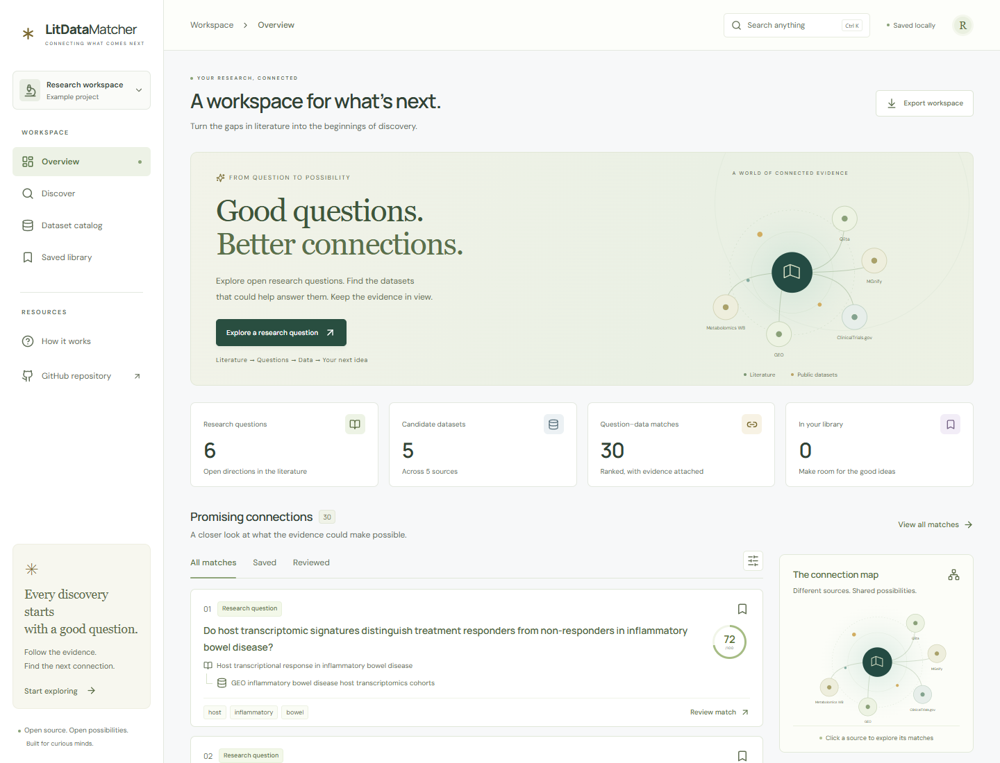
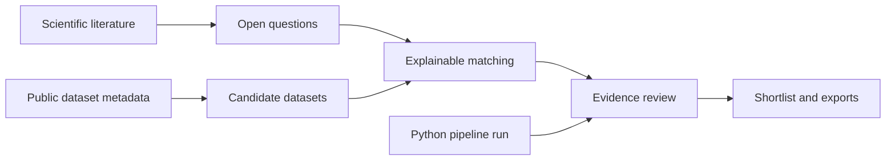

# LitDataMatcher

### From open questions to research possibilities.

A research workspace that connects questions in scientific literature with public datasets worth investigating. Explore the evidence, understand the ranking, and build a reviewable shortlist—with a reproducible Python pipeline underneath.

[](https://github.com/ericrosenn1/LitDataMatcher/actions/workflows/ci.yml)
[](LICENSE)
[](pyproject.toml)
[](web/)



**[Run the app](#run-the-app)** · **[How it works](#how-it-works)** · **[Python pipeline](#use-the-python-pipeline)** · **[App guide](docs/web-app.md)** · **[Architecture](docs/architecture.md)**

## A workspace for the next question

The useful part of a paper is sometimes what remains unresolved. LitDataMatcher brings those open questions together with candidate data sources, while keeping the original evidence and the limits of each match visible.

| Explore | Inspect | Keep the work |
| --- | --- | --- |
| Start with an offline demo or search live literature and dataset metadata. | Open a question–dataset pair to see source text, ranking components, and caveats. | Save a shortlist, add review notes, and export CSV or JSON. |
| Browse candidate datasets and follow their source links. | Distinguish illustrative records from live metadata and imported pipeline outputs. | Import a Python pipeline run into the same visual workspace. |

The web app runs in your browser. The bundled demo needs no account, API key, Python environment, or GPU.

## Run the app

Install Node.js 22.12 or newer, then run from the repository root:

```bash
npm --prefix web ci
npm --prefix web run dev
```

Open the local URL printed by Vite. The app starts with a clearly labeled demonstration workspace.

To build and preview the production app:

```bash
npm --prefix web run build
npm --prefix web run preview
```

The static build is written to `web/dist/`. Publishing is a separate step; these commands do not deploy a site.

## How it works



The app supports three complementary workflows:

1. **Explore the demo.** A reproducible example illustrates extraction, matching, and review. Its literature examples and catalog summaries are illustrative, not a validated scientific result.
2. **Search live sources.** Query Europe PMC for literature and DataCite for dataset metadata. Inspect the returned records and follow their original links. The browser ranks candidate pairs with an explainable lexical method.
3. **Review a pipeline run.** Import `matches.jsonl` produced by the Python package, or reopen an exported app workspace. Keep source evidence and recorded score components alongside review decisions.

Pasted text can also be analyzed in the browser against the workspace’s candidate datasets. The interface distinguishes extracted future directions from broader topic matches.

### What a score means

A high score identifies a candidate to inspect. It does **not** establish that a dataset contains the necessary measurements, that access is permitted, or that a study can answer the question. Browser rankings are lexical heuristics; imported Python rankings retain their own component values. Neither is a calibrated probability or a validated measure of scientific feasibility.

Dataset access, licenses, population compatibility, variables, and study design require review against the original records. Missing metadata remains unknown. See the [app methodology](docs/web-app.md#methodology-and-limits) and [scientific limitations](docs/limitations.md).

## Use the Python pipeline

The existing Python package remains the reproducible processing path: literature extraction, variable harmonization, candidate discovery, evidence synthesis, heuristic feasibility and governance checks, ranking, and auditable artifacts.

Python 3.10 or newer:

```bash
python -m venv .venv
```

Activate the environment with `.venv\Scripts\Activate.ps1` on Windows or `source .venv/bin/activate` on macOS/Linux, then:

```bash
python -m pip install -e ".[dev]"
python -m litdatamatcher.cli demo --out run/demo
```

Run on your own JSONL literature corpus:

```bash
python -m litdatamatcher.cli run --input papers.jsonl --out run/research --top-n 100
```

Each input line is a JSON record:

```json
{"title":"Paper title","abstract":"Abstract text","text":"Optional full text","doi":"Optional DOI"}
```

Use an optional dataset catalog with `--catalog datasets.jsonl`. The default catalog supports deterministic offline demonstrations; it is not an exhaustive inventory of available data.

| Artifact | Purpose |
| --- | --- |
| `matches.jsonl` | Ranked pairs with evidence and component scores; import into the app. |
| `questions.jsonl`, `datasets.jsonl`, `syntheses.jsonl` | Inspectable outputs from individual processing stages. |
| `review_sheet.csv`, `review_sheet.jsonl` | Expert annotation and external review. |
| `litdatamatcher.sqlite` | Queryable run records. |
| `summary.md`, `publication_report.md`, `metrics.jsonl` | Run reporting and computational accounting. |

The core pipeline does not require network access or a GPU. Optional NLP/model dependencies are available through `.[nlp,ml]`; installing them does not change the browser app’s matching method. Legacy streaming workers remain available for development and demonstration.

## Built for inspection

- **Evidence stays attached.** Source text, identifiers, links, and ranking components travel with candidate matches.
- **Review remains a human decision.** Save pairs and record assessments without converting a ranking into a scientific claim.
- **The offline path is reproducible.** Python stages write explicit JSONL and SQLite artifacts.
- **The browser app is portable.** React, TypeScript, and Vite produce static assets with bundled fonts and no application server requirement.
- **Data boundaries are visible.** Demo, live, and imported workspaces have distinct provenance.

Saved matches and notes stay in the browser’s research library when you change workspaces or reload. Export from the library to retain that saved collection; exports elsewhere contain the active workspace. Live searches send the query to Europe PMC and DataCite. Imported files and pasted text are processed locally by the app; there is no account system or cloud synchronization. Export work that needs to be retained or shared.

## Development and validation

```bash
npm --prefix web run typecheck
npm --prefix web test
npm --prefix web run build
python -m pytest
```

For desktop/mobile browser checks and automated accessibility checks, install Chromium once and run:

```bash
cd web
npx playwright install chromium
npm run test:e2e
```

Python and web CI run independently. The web workflow also packages the static build as an artifact. Playwright exercises the app at desktop and mobile sizes, and axe checks selected interface states. See the [validation record](docs/app-validation.md) for measured results and coverage limits. Passing software checks establishes computational behavior, not scientific validity.

For technical details, see the [web app guide](docs/web-app.md), [node contracts](docs/node_contracts.md), [reproducibility notes](docs/reproducibility.md), and [model robustness plan](docs/model_robustness_plan.md).

## Citation and license

Created by **Eric Rosenn**. Use [CITATION.cff](CITATION.cff) to cite the software. Source code is available under the [MIT license](LICENSE); external literature and datasets retain their own terms.
