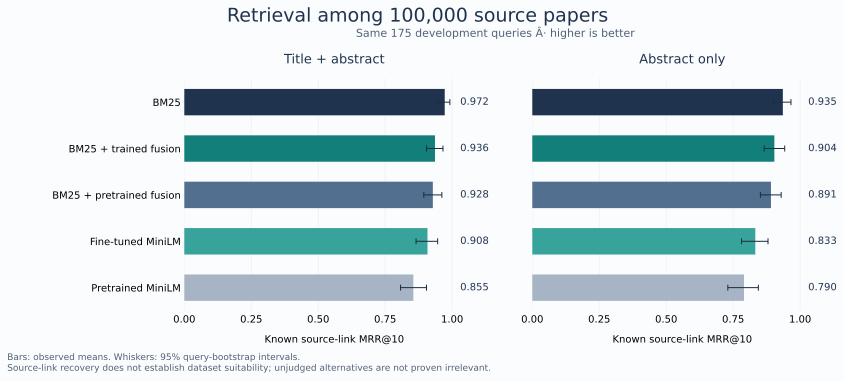

# LitDataMatcher

**A local research engine for connecting biomedical questions to public data.**

LitDataMatcher turns literature and explicit research questions into typed data
requirements, source-linked evidence, and ranked dataset candidates. Unknowns,
failed retrievals, conflicting evidence, and underdetermined questions remain
visible throughout the workflow.

The integrated [scientific application](docs/full_platform.md) now runs the Python
engine from the browser, with persistent jobs, requirement-level evidence and
reproducible dossier exports. [Current PubMed indexing](docs/literature_index.md)
and [dataset inspection](docs/campaign_20261031/dataset_inspection.md) provide the
underlying source interfaces. Independent scientific validation remains pending.

[Research workflow](docs/research_workflow.md) · [Methods](docs/campaign_20261031/retrieval_protocol.md) · [Recovery](docs/campaign_20261031/workflow_recovery.md) · [Scientific limits](docs/limitations.md) · [MIT license](LICENSE)

## Research capabilities

- **Source-grounded local inference:** exact source spans, bounded repair, and independent checks for relation direction, negation, and unsupported context.
- **Typed question compilation:** entities, outcomes, comparisons, population and design requirements, with explicit abstention when information is missing.
- **Configurable source discovery:** bounded PubMed, GEO, ClinicalTrials.gov, DataCite and other adapters, immutable responses, and query-level coverage receipts.
- **Inspectable matching:** observed and unknown capabilities, study-dependence tracking, requirement-by-requirement assessments, and portable dossiers.
- **Reproducible retrieval experiments:** BM25, pretrained dense retrieval, rank fusion, local fine-tuning, paired development comparisons, and verified vector caches.
- **Recoverable execution:** leased workspaces, strict artifact validation, checkpointed stages, explicit retries, and preserved failure records.


## Start locally

Python 3.10 or newer is required. The core package runs without a GPU or model downloads.

```bash
python -m venv .venv
# Windows: .venv\Scripts\activate
# macOS/Linux: source .venv/bin/activate
python -m pip install -e ".[dev,corpus]"
litdatamatcher demo --out runs/demo
```

The deterministic demo uses illustrative data. Inspect a research question without loading a model:

```bash
litdatamatcher-v2 compile --question "Does treatment reduce IL6 in human cells?"
```

Acquire a bounded biomedical workspace:

```bash
litdatamatcher-discover --plan examples/discovery-plan.json --out runs/biomedical --workers 2
```

Edit the [example query plan](examples/discovery-plan.json) for the intended study.
Use `--offline --resume` to verify completed source checkpoints, or add
`--retry-failed` to retry failed nodes while retaining their previous receipts.

## Local model workflow

```bash
python -m pip install -e ".[runtime,structured]"
```

Prepare models explicitly with [runtime_download_models.py](scripts/v2/runtime_download_models.py)
and an immutable revision, or provide existing directories with verified
`MODEL_MANIFEST.json` files. The research configuration uses Qwen2.5-7B-Instruct
and all-MiniLM-L6-v2. Model weights are not bundled in Git.

Qualify the chosen runtime on a known positive development document. The JSON
input supplies `document_id`, `title`, and `text`; this is an execution and
source-checking smoke test, not a scientific accuracy benchmark.
The campaign's selection rule requires two positive development documents:
repeat qualification with the second document and a separate output directory,
and proceed only when both pass. The example analysis references the first
receipt for the same qualified backend.

```bash
python scripts/v2/runtime_qualify.py --model-dir /path/to/extractor --embedding-dir /path/to/encoder --document /path/to/positive-source.json --output runs/qualification/QUALIFICATION.json --device cuda --decoding-mode source_literal --max-new-tokens 384 --require-claims
litdatamatcher-v2 analyze --root runs/biomedical --out runs/analysis-01 --model /path/to/extractor --embeddings /path/to/encoder --limit 3 --chunks 2 --device cuda --decoding-mode source_literal --max-new-tokens 384 --runtime-qualification runs/qualification/QUALIFICATION.json
```

Use `--device cpu` where suitable. Repeat the same command with `--resume`
after interruption. `--vector-cache /path/to/cache` reuses verified dataset
vectors. Source, model, configuration, or implementation changes require a new run.

See the [local model guide](docs/campaign_20261031/model_source_schema.md) for
structured decoding and offline qualification, and the
[research workflow](docs/research_workflow.md) for output contracts.

For many papers, the [batch command](docs/campaign_20261031/native_batch.md)
reuses one model session while keeping separate case journals and outputs:

```bash
litdatamatcher-v2 batch --root runs/biomedical --inputs cases.jsonl --out runs/batch-01 --model /path/to/extractor --embeddings /path/to/encoder --device cuda --decoding-mode source_literal --max-new-tokens 384 --runtime-qualification runs/qualification/QUALIFICATION.json
```

Each case supplies a source document and optional explicit question. The
[model card](docs/model_card.md) describes training data, selection rules,
qualified configurations, and limits on interpretation.
The [literal decoder](docs/campaign_20261031/model_source_literal.md) preserves
exact source text through escaped JSON. The earlier profiles remain available
for reproducibility.

## Measured development evidence

Training uses **1,333 source-linked queries**. The same **175 paper-disjoint
development queries** were evaluated against 1,508, 50,000, and 100,000 candidate
papers. Official test partitions and reserved evaluation data are excluded.
The larger pools add qualified annual-baseline distractors without retraining.

**MRR@10 with 100,000 candidate papers:**

| Method | Title + abstract | Abstract only |
| --- | ---: | ---: |
| BM25 | **0.9722** | **0.9354** |
| BM25 + trained dense fusion | 0.9359 | 0.9038 |
| BM25 + pretrained dense fusion | 0.9279 | 0.8910 |
| Fine-tuned MiniLM | 0.9079 | 0.8326 |
| Pretrained MiniLM | 0.8551 | 0.7903 |



Fine-tuning improves its pretrained parent by **0.0528 MRR** with title and
abstract (paired query-bootstrap 95% interval: 0.0217–0.0841), and by **0.0423**
with abstracts alone (0.0077–0.0780). **BM25 leads every measured condition.**
The aggregate gain is source-dependent: PubMedQA performance decreases in both
abstract-only pools. Many original queries echo source titles, so these results
measure known source-link recovery, not general question answering or dataset
suitability.

Verified warm loading of 100,000-document vectors took **1.29–1.43 seconds** in
the recorded local runs, versus **101–111 seconds** for fresh encoding. Model
initialization is recorded separately. These are hardware-dependent cache
measurements, not a claim that fresh model inference runs at cache speed.

See the [complete scale results](benchmarks/campaign_20261031/retrieval_scale.json),
[initial development experiment](benchmarks/campaign_20261031/retrieval_development.json),
[fixed training protocol](docs/campaign_20261031/retrieval_protocol.md), and
[scale evaluation procedure](docs/campaign_20261031/retrieval_scale.md).
An independent audit checked all 3,500 query/method ranking lists, 20 condition
metrics, and all four vector encodings.

Other evidence includes a frozen 30-case development pack, real processed-table
inspections, source-adapter replay, and an annual PubMed baseline integrity audit.
The [case and data notes](docs/campaign_20261031/research_cases.md) distinguish
measured values from missing evidence. The
[extraction comparison](docs/campaign_20261031/extraction_results.md) retains all
30 case outcomes, including abstentions and unresolved dataset suitability:

| Development endpoint | Original decoder | Literal decoder |
| --- | ---: | ---: |
| Returned source views | 43 / 45 | 45 / 45 |
| Source-guard-accepted claims | 16 | 20 |
| Cases requiring a technical retry | 2 | 0 |

All 30 literal-run cases passed the artifact and source-span audit and were
reused unchanged on resume. These are software and source-fidelity results;
accepted counts are not scientific accuracy, and all 140 dataset candidates
still required inspection.
The independently audited [revision ledger](docs/campaign_20261031/pubmed_revision_ledger.md)
covers **1,621 PubMed shards**, preserving **45,477,637 citation upsert events**
and **11,293 deletion events**. It records historical revisions without claiming
a materialized current view. That earlier campaign's integrated suite passed
**1,317 tests** with two platform-specific skips; this is a historical result.

The earlier [specification](docs/research_campaign_20261031.md) and
[state](project_state/campaign_20261031/TASK_STATE.json) remain preserved.
The current full-platform campaign has its own
[request](project_state/full_platform_20261031/REQUEST.md) and
[structured state](project_state/full_platform_20261031/STATE.json).
[Integrated source-selection acceptance](docs/campaign_20261031/question_selection.md)
records 1,491 passing Python tests with two platform skips, 43 passing browser
checks with one intentional skip, actual source-reference workflows, and a fresh
installed-package HTTP demonstration. Subsequent corpus and scale repairs have
their own targeted checks and commit-bound receipts.

The [100,000-abstract continuation](docs/campaign_20261031/question_scale_100000.md)
preserved completed work and produced 7,883 literal passages, with explicit
sampling and timing limits. [Twelve descriptive comparisons](docs/campaign_20261031/descriptive_comparisons.md)
pass source-scoped contracts over two datasets; they are not twelve independent
or newly unanswered opportunities. Independent scientific review and final
evaluation remain pending under the [protocol draft](docs/campaign_20261031/scientific_evaluation_readiness.md).

## Outputs and review

Native runs produce a manifest, accepted claims and questions, evidence bundles,
candidate assessments, no-fit or underdetermined outcomes, an expert review sheet,
and a local HTML dossier. Rejected model attempts remain diagnostic artifacts.
Blank expert-review fields are intentional. Scores are uncalibrated review
priorities; scientific validity and dataset answerability require further evidence.

The [integrated browser workflow](docs/full_platform.md) runs the Python engine
and exposes persistent jobs, requirements, compatibility evidence and exports.
The CLI and native research artifacts remain available, alongside the lighter
browser-only Discover mode.

## Repository map

| Location | Role |
| --- | --- |
| `litdatamatcher/` | Engine, contracts, adapters, models, retrieval, orchestration |
| `scripts/campaign_20261031/` | Reproducible experiments and data qualification |
| `tests/` | Unit, integration, source-fidelity, and fault-injection checks |
| `benchmarks/` | Small versioned protocols and validation summaries |
| `docs/` | Methods, usage, limitations, and historical evidence |
| `examples/` | Executable configurations |
| `web/` | Optional browser workspace |
| `archive/`, `workflows/legacy_streaming/` | Preserved historical implementations |

Large corpora, environments, model weights, and transient outputs stay outside
Git. Run `python -m pytest` to test the project. Install the build frontend with
`python -m pip install build`, then run `python -m build` to create the package.
CI separately checks core contracts, local-model contracts, package installation,
documentation, and the web workspace.

For academic use, cite the exact commit or release used; see [CITATION.cff](CITATION.cff).
Contributions should preserve provenance, negative findings, scientific assumptions,
and compatibility of validated runs.
