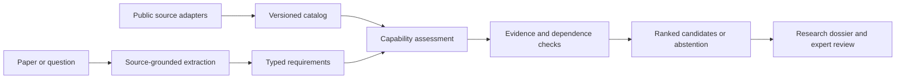

# LitDataMatcher

**A local research engine for connecting biomedical questions to public data.**

LitDataMatcher turns literature and explicit research questions into typed data
requirements, source-linked evidence, and ranked dataset candidates. Unknowns,
failed retrievals, conflicting evidence, and underdetermined questions remain
visible throughout the workflow.

[Research workflow](docs/research_workflow.md) · [Methods](docs/campaign_20261031/retrieval_protocol.md) · [Recovery](docs/campaign_20261031/workflow_recovery.md) · [Scientific limits](docs/limitations.md) · [MIT license](LICENSE)

## Research capabilities

- **Source-grounded local inference:** exact source spans, bounded repair, and independent checks for relation direction, negation, and unsupported context.
- **Typed question compilation:** entities, outcomes, comparisons, population and design requirements, with explicit abstention when information is missing.
- **Configurable source discovery:** bounded PubMed, GEO, ClinicalTrials.gov, DataCite and other adapters, immutable responses, and query-level coverage receipts.
- **Inspectable matching:** observed and unknown capabilities, study-dependence tracking, requirement-by-requirement assessments, and portable dossiers.
- **Reproducible retrieval experiments:** BM25, pretrained dense retrieval, rank fusion, local fine-tuning, paired development comparisons, and verified vector caches.
- **Recoverable execution:** leased workspaces, strict artifact validation, checkpointed stages, explicit retries, and preserved failure records.



## Start locally

Python 3.10 or newer is required. The core package runs without a GPU or model downloads.

```bash
python -m venv .venv
# Windows: .venv\Scripts\activate
# macOS/Linux: source .venv/bin/activate
python -m pip install -e ".[dev,corpus]"
litdatamatcher demo --out runs/demo
```

The deterministic demo uses illustrative data. Inspect a research question without loading a model:

```bash
litdatamatcher-v2 compile --question "Does treatment reduce IL6 in human cells?"
```

Acquire a bounded biomedical workspace:

```bash
litdatamatcher-discover --plan examples/discovery-plan.json --out runs/biomedical --workers 2
```

Edit the [example query plan](examples/discovery-plan.json) for the intended study.
Use `--offline --resume` to verify completed source checkpoints, or add
`--retry-failed` to retry failed nodes while retaining their previous receipts.

## Local model workflow

```bash
python -m pip install -e ".[runtime,structured]"
```

Prepare models explicitly with [runtime_download_models.py](scripts/v2/runtime_download_models.py)
and an immutable revision, or provide existing directories with verified
`MODEL_MANIFEST.json` files. The research configuration uses Qwen2.5-7B-Instruct
and all-MiniLM-L6-v2. Model weights are not bundled in Git.

```bash
litdatamatcher-v2 analyze --root runs/biomedical --out runs/analysis-01 --model /path/to/extractor --embeddings /path/to/encoder --limit 3 --chunks 2 --device cuda
```

Use `--device cpu` where suitable. Repeat the same command with `--resume`
after interruption. `--vector-cache /path/to/cache` reuses verified dataset
vectors. Source, model, configuration, or implementation changes require a new run.

See the [local model guide](docs/campaign_20261031/model_source_schema.md) for
structured decoding and offline qualification, and the
[research workflow](docs/research_workflow.md) for output contracts.

## Measured development evidence

The first frozen experiment uses **1,333 training queries, 175 development
queries, and 1,508 source papers**. Training and development paper identities
and text are disjoint. Official test partitions and reserved evaluation data
are excluded.

| Method | Development MRR@10 |
| --- | ---: |
| BM25 | 0.9921 |
| BM25 + pretrained dense fusion | 0.9700 |
| Locally fine-tuned dense encoder | 0.9522 |
| Pretrained dense encoder | 0.9302 |

Fine-tuning improves its pretrained parent by **0.0220 MRR** (paired query-bootstrap
95% interval: 0.0033–0.0432), while BM25 remains stronger. Many PubMedQA queries
echo their source titles; larger candidate pools and an abstract-only diagnostic
are being evaluated separately. These measure **known source-paper recovery**,
not whether a dataset can answer a question.

See the [results and independent audit summary](benchmarks/campaign_20261031/retrieval_development.json),
[fixed protocol](docs/campaign_20261031/retrieval_protocol.md), and
[training procedure](docs/campaign_20261031/retriever_training.md).

Other evidence includes a frozen 30-case development pack, real processed-table
inspections, source-adapter replay, and an annual PubMed baseline integrity audit.
The [case and data notes](docs/campaign_20261031/research_cases.md) distinguish
measured values from missing evidence. The active campaign's
[specification](docs/research_campaign_20261031.md) and
[structured state](project_state/campaign_20261031/TASK_STATE.json) track completed
work and remaining validation.

## Outputs and review

Native runs produce a manifest, accepted claims and questions, evidence bundles,
candidate assessments, no-fit or underdetermined outcomes, an expert review sheet,
and a local HTML dossier. Rejected model attempts remain diagnostic artifacts.
Blank expert-review fields are intentional. Scores are uncalibrated review
priorities; scientific validity and dataset answerability require further evidence.

The optional [web workspace](docs/web-app.md) provides a visual review surface.
The Python engine, CLI, and research artifacts are the primary application.

## Repository map

| Location | Role |
| --- | --- |
| `litdatamatcher/` | Engine, contracts, adapters, models, retrieval, orchestration |
| `scripts/campaign_20261031/` | Reproducible experiments and data qualification |
| `tests/` | Unit, integration, source-fidelity, and fault-injection checks |
| `benchmarks/` | Small versioned protocols and validation summaries |
| `docs/` | Methods, usage, limitations, and historical evidence |
| `examples/` | Executable configurations |
| `web/` | Optional browser workspace |
| `archive/`, `workflows/legacy_streaming/` | Preserved historical implementations |

Large corpora, environments, model weights, and transient outputs stay outside
Git. Run `python -m pytest` and `python -m build` to test and package the project.
CI separately checks core contracts, local-model contracts, package installation,
documentation, and the web workspace.

For academic use, cite the exact commit or release used; see [CITATION.cff](CITATION.cff).
Contributions should preserve provenance, negative findings, scientific assumptions,
and compatibility of validated runs.
