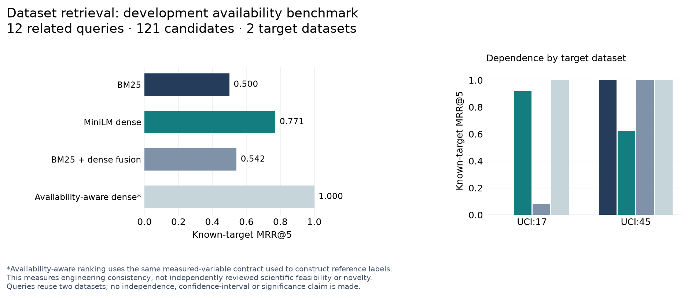

# Dataset ranking development comparison



This executed comparison uses 12 explicit variable-availability questions over
two inspected UCI tables and 119 additional real repository metadata records.
The resulting deduplicated pool has 121 accessions. These are development
examples with deterministic source-variable labels; they are not independent
expert assessments, novel questions, or a sealed scientific evaluation.

Candidate retrieval text contains source titles, descriptions and inspected
variable definitions. The query and reference label are not inserted into
candidate text. Metadata alternatives remain unjudged, so the reported metrics
measure recovery of the known processed-table target, not scientific precision
or exhaustive dataset recall. The query denominator is 12; the number of
distinct positive data assets is two. No significance test is warranted here.

| Method | Known target first | Recall at 5 | MRR at 5 | nDCG at 5 |
| --- | ---: | ---: | ---: | ---: |
| BM25 | 0.5000 | 0.5000 | 0.5000 | 0.5000 |
| MiniLM dense | 0.5833 | 1.0000 | 0.7708 | 0.8295 |
| Hybrid reciprocal rank fusion | 0.5000 | 0.6667 | 0.5417 | 0.5718 |
| Requirement-aware dense | 1.0000 | 1.0000 | 1.0000 | 1.0000 |

The hybrid result is worse than dense retrieval on this pool and is retained.
The requirement-aware perfect result checks the same availability contract used
to create the labels. It demonstrates engineering consistency, not independent
scientific validity. All four controls were handled correctly: two unavailable
measurement requests were rejected and two independence requests remained
uncertain. Full scientific qualification remains **zero** in the source
demonstration because design requirements are unresolved.

MiniLM used the existing local revision
`1110a243fdf4706b3f48f1d95db1a4f5529b4d41` on CPU with four Torch threads. No model
download, training, or holdout access occurred. This run took about 0.009 seconds
for BM25 fit and queries, 6.52 seconds for dense model initialization, indexing
and batched queries, 0.002 seconds for fusion, and 0.031 seconds for requirement
reranking after retrieval. RSS rose from approximately 516 MB to 841 MB; peak
memory was not measured. These are single local-run timings, not scale claims.

```powershell
& 'C:\Codex\LitDataMatcher-v2\runtime-env\Scripts\python.exe' -m scripts.campaign_20261031.benchmark_dataset_ranking --inputs 'C:\Codex\LitDataMatcher-v2\data\full_platform_20261031\dataset-qualification-v2' --model 'C:\Codex\LitDataMatcher-v2\data\models\all-MiniLM-L6-v2\1110a243fdf4706b3f48f1d95db1a4f5529b4d41' --out 'C:\Codex\LitDataMatcher-v2\data\full_platform_20261031\dataset-ranking-new'
```

Repeating a command with the same output directory consumes the existing
fingerprinted checkpoint and verifies outputs before returning. The successful
resume preserved the comparison SHA-256
`5cd4e1733d508fd2a066f680dd8b9e6f85bf2a40383c2a11bda88de07c07c09a`.
Input, implementation and model identities, every ranking, candidate text and
timing are retained under `dataset-ranking-v2`. A compact committed receipt is
`benchmarks/campaign_20261031/dataset_ranking.json`.

The figure and per-method CSV can be reproduced without rerunning retrieval:

```powershell
python scripts/campaign_20261031/plot_dataset_results.py --source benchmarks/campaign_20261031/dataset_ranking.json --out local/dataset-figures
if ($LASTEXITCODE -ne 0) { throw 'Dataset figure validation failed' }
```

The `report` extra supplies Matplotlib. The renderer checks every reported MRR
against its individual query values and writes PNG, SVG, PDF, CSV and a hashed
figure manifest. Results are descriptive; queries sharing a dataset are not
treated as independent scientific replicates.
