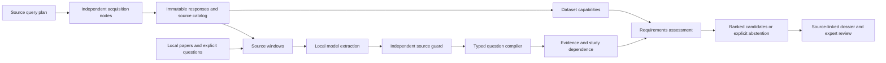

# Research workflow and evidence contracts

LitDataMatcher produces reviewable question–dataset candidates. Its primary
research path is `litdatamatcher-v2`; the deterministic `litdatamatcher demo`
remains a lightweight installation check and teaching example.

## Execution paths

| Path | Purpose | Runtime requirements |
| --- | --- | --- |
| `litdatamatcher-discover` | Execute a bounded user-defined source query plan | Network for acquisition; cached offline replay available |
| `litdatamatcher-v2 compile` | Inspect the typed answer specification for a question | CPU, no model |
| `litdatamatcher-v2 analyze` | Extract, compile, assess, and report one research run | Explicit locally prepared extractor and encoder |
| `litdatamatcher-controller` | Persist subprocess work and validate expected artifacts | CPU; resources of the registered commands |
| `python scripts/campaign_20261031/train_retriever.py` | Reproduce the fixed development retrieval experiment | Qualified corpus-derived benchmark and local encoder |
| `litdatamatcher demo` | Exercise the deterministic reference pipeline | Core Python installation |

See [configurable discovery](campaign_20261031/discovery.md),
[model preparation and structured decoding](campaign_20261031/model_source_schema.md),
and [workflow recovery](campaign_20261031/workflow_recovery.md) for commands and
failure behavior. The browser workspace is an optional review interface.

## What each boundary guarantees

**Acquisition** retains raw response hashes, retrieval times, request scope,
adapter versions, and partial coverage. An empty provider response differs from
a failed request. A registry record describes a study; it does not establish
available participant-level data.

**Extraction** uses explicitly supplied local model files. Runtime inference
does not download a model, execute remote model code, or call a paid API. The
optional structured decoders restrict quotes to complete source sentences.
The [literal profile](campaign_20261031/model_source_literal.md) preserves escaped
source text; earlier profiles remain available for reproducing older runs.
The independent guard still verifies subject–predicate–object spans, direction,
negation, and context. Unsupported output is rejected, with diagnostic evidence.

**Compilation** translates a question into required entities, relationships,
comparators, population, outcome, and design constraints where these are
supported. Missing information produces `QUESTION_UNDERDETERMINED`. A complete
computer-readable contract is not a determination that the scientific question
is well designed or answerable.

**Assessment** keeps observed metadata, plausible derivations, unknowns, and
contradictions distinct. Missing capability evidence is not evidence of absence.
Study identifiers and dependence groups prevent duplicate repository records
from masquerading as independent studies. Rank scores prioritize review; they
are not calibrated probabilities of correctness or successful analysis.

**Recovery** verifies source, model, configuration, and implementation identities.
Completed extraction, compilation, and matching stages have durable checkpoints.
Corrupt derivatives cannot silently become accepted results. Controller retries
are limited to explicitly configured transient exit codes; permanent failures
remain failures. Source jobs can run concurrently; shared model execution is
serialized to avoid unsafe concurrent generation.

## Inspectable outputs

| Artifact | Use |
| --- | --- |
| `RUN_MANIFEST.json` | Execution status, source/model/configuration identities, coverage, failures, artifact hashes |
| `claims.jsonl`, `questions.jsonl` | Accepted source-linked extractions and compiled questions |
| `evidence_bundles.jsonl` | Evidence, uncertainty, provenance, and study dependence |
| `matches.jsonl` | Ranked candidates with requirement-by-requirement assessments |
| `candidate_outcomes.jsonl` | No-fit, underdetermined, and other non-ranking outcomes |
| `review_sheet.csv` | Empty expert-review fields; no fabricated expert judgments |
| `report.html` | Portable local dossier with escaped source content |

Exact files and counts are listed in each run manifest. An empty JSONL file can
be a valid zero-result artifact. A successful process exit alone is insufficient
to validate a run.

## Reproducible comparison

The campaign separates three kinds of evidence:

1. Engineering fixtures test invariants, corruption, interruptions, and recovery.
2. Source-linked development benchmarks measure retrieval and extraction
   behavior on declared inputs.
3. Expert scientific validation would assess the actual suitability of a dataset
   for a question. It is not implied by either of the first two.

The [retrieval protocol](campaign_20261031/retrieval_protocol.md) fixes the
training split and primary metrics. The [frozen research cases](campaign_20261031/research_cases.md)
retain original paper identities. Reserved evaluation text and the historical
sealed holdout are excluded from development. Negative results and unsuccessful
model candidates remain in the evidence record.

Large source corpora, checkpoints, virtual environments, and model weights live
outside Git. The repository holds source code, small examples, protocols, and
compact validation summaries. Historical implementations under `archive/` and
`workflows/legacy_streaming/` are retained for provenance.
